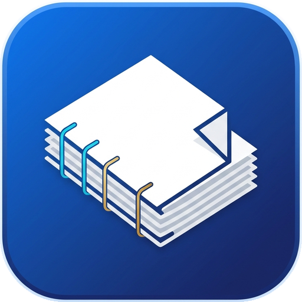

<p align="center">
  
</p>

<h1 align="center">PDF Baskı Atölyesi</h1>

<p align="center">
  <strong>Windows ve Linux için vektörel (kayıpsız) PDF baskı, cilt payı, numaralandırma, birleştirme ve kitapçık montaj stüdyosu.</strong>
</p>

<p align="center">
  <a href="https://github.com/akdrhmz/pdf-baski-atolyesi/releases/latest"><strong>İndir (Releases)</strong></a> ·
  <a href="#özellikler">Özellikler</a> ·
  <a href="#kurulum-ve-çalıştırma">Kurulum</a> ·
  <a href="CHANGELOG.md">Değişiklikler</a> ·
  <a href="#lisans-ve-iletişim">Lisans</a>
</p>

---

**Sürüm:** `core/version.py` (güncel: `2.11.0`) · **Lisans:** [MIT](LICENSE) (Ücretsiz ve Açık Kaynak) · **İletişim:** support@kadirhamza.com

PyMuPDF ve PySide6 (Qt 6) ile geliştirilen **PDF Baskı Atölyesi**, kaynak PDF'lere asla dokunmadan atomik kayıt, işlem öncesi kırpma riski taraması ve işlem sonrası piksel/metin doğrulaması ile baskıya hazır PDF'ler üretir.

---

## İndir (Hazır Kurulum Paketleri)

Python veya sanal ortam kurmadan doğrudan çalıştırmak için [Releases](https://github.com/akdrhmz/pdf-baski-atolyesi/releases/latest) sayfasından sisteminize uygun paketi indirin:

| Platform | Paket | Açıklama |
| :--- | :--- | :--- |
| **Windows (Kurulum)** | `PDF_Baski_Atolyesi_<sürüm>_Setup.exe` | Başlat Menüsü ve Masaüstü kısayollu standart kurulum |
| **Windows (Taşınabilir)** | `PDF_Baski_Atolyesi_<sürüm>_Portable.exe` | Kurulum gerektirmeyen tek dosya `.exe` |
| **Fedora / RHEL / openSUSE** | `pdf-baski-atolyesi-<sürüm>-1.x86_64.rpm` | `sudo dnf install ./pdf-baski-atolyesi-*.rpm` |
| **Ubuntu / Debian / Pardus / Mint** | `pdf-baski-atolyesi_<sürüm>_amd64.deb` | `sudo apt install ./pdf-baski-atolyesi_*.deb` |
| **Tüm Linux Dağıtımları** | `PDFBaskiAtolyesi-v<sürüm>-linux-x86_64.tar.gz` | Arşivi açıp `./install.sh` çalıştırın |

---

## Özellikler

### 1. Sayfa Düzeni
* **Duplex Cilt Payı:** Tek ve çift sayfalar için ayrı X/Y ofseti; soldan, sağdan ve üstten ciltleme; hazır şablonlar (*Tez*, *Spiral cilt*, *Sıcak tutkal cilt*, *Kitapçık*) ve 10 / 15 / 20 mm hızlı düğmeler.
* **Alt / Üst Boşluk & Kitapçık Tamamlama:** Sabit alt/üst pay ekleme ve kitapçık baskı için sayfa sayısını otomatik 4'ün katına tamamlama.
* **Sayfa Boyutu & Eşitleme ("Sığdır"):** Karışık ebatlı PDF'leri *A5 / A4 / A3 / Özel* ebatlara veya ilk/en büyük/baskın sayfaya oranını bozmadan sığdırma; yatay sayfaları koruma ya da 90° döndürme.
* **Özel Sayfa Kuralları:** Belirli sayfalarda veya ara kapaklarda cilt/boşluk kurallarını ayrı yönetme (katlanabilir bölüm).
* **Taşma Kontrolü:** *Sayfa uzasın* (varsayılan, kırpmaz), *İçerik küçülsün* veya *Taşan kırpılsın*.

### 2. Sayfa Numaraları
* **Konum & Stil:** Yatay (*Dış kenar*, *Alt orta*, *İç kenar*) ve dikey (*Alt kenar*, *Üst kenar*) konum; yazı rengi seçimi (`QColorDialog`); özel şablonlar (`{n}`, `{N}`, `{roman}`, `{ROMAN}`).
* **Bölüm Numaralandırması:** Romen rakamından Arap rakamına geçiş, bölüm başında numara gizleme ve sağ sayfada başlatmak için otomatik boş sayfa ekleme.
* **Numarasız Sayfalar:** Ara kapaklar için numara atlama ve ardışık sayacı koruma.

### 3. PDF Birleştirme
* **Kayıpsız Birleştirme & Görsel Ekleme:** Birden fazla PDF'i ve görseli (`.png`, `.jpg`, `.webp`, `.bmp`, `.tif`) sürükle-bırak ile sıralama, dosya başına döndürme (0/90/180/270°) ve sayfa aralığı seçimi.
* **Çoklu Seçim & Akıcı Liste:** `Ctrl+tık`, `Shift+tık`, `Ctrl+A`, `Del`, `Alt+↑/↓`; 56×72 küçük resimler ve yer imi (TOC) aktarımı.
* **Tek Geçişte Uygulama:** Birleştirdikten sonra Sayfa Düzeni ve Numaralandırma ayarlarını tek seferde uygulama veya bağımsız ebat eşitleme.

### 4. Baskı ve Araçlar *(Ana Canlı Önizlemeye Entegre)*
* **Sayfaları Düzenle:** Küçük resim ızgarasında sürükle-bırak sıralama, sayfa döndürme, seçili sayfaları ayıklama veya N'er sayfalık parçalara bölme.
* **Filigran & Bates:** Şeffaf filigran metni (renk, açı, saydamlık, sayfa aralığı) ve belge takip numarası (Bates) ekleme.
* **Baskı Montajı:** Kitapçık (forma kalınlığı ve iç sayfa kayma/creep telafisi), 2-up (yatayda `2×1`, dikeyde `1×2`), 4-up (`2×2`), RTL (sağdan-sola) dizilim, kesim işaretleri, taşma payı (TrimBox/BleedBox) ve ayırıcı çizgiler.
* **Güvenlik & Meta Veri:** AES-256 açılış/izin parolası, yazdırma/kopyalama izinleri, başlık/yazar düzenleme veya temizleme, taranmış PDF'ler için DPI bazlı görsel sıkıştırma.

### Canlı Önizleme, Toplu İşlem ve CLI
* **Canlı Önizleme:** Çift sayfa açılımı, yakınlaştırma (`Ctrl+tekerlek`), sürükleyerek kaydırma, görünümü döndürme, *Önce / Sonra* karşılaştırması, tam ekran ve ayrı pencere kipi.
* **Toplu İşlem:** Klasör/alt klasör bazlı toplu PDF işleme (GUI kuyruğu + `studio_cli.py`).
* **Kalite Güvencesi:** İşlem öncesi kırpma riski taraması, işlem sonrası metin + piksel doğrulama raporu, JSON profil dışa/içe aktarma ve tanılama paketi (`.zip`).

```bash
python studio_cli.py --profile "ayarlar.json" --input "./PDFler" --output "./Ciktilar" --recursive
```

---

## Kaynak Koddan Kurulum ve Paketleme

Python **3.10+** (3.12 önerilir) gerekir.

### Linux
```bash
git clone https://github.com/akdrhmz/pdf-baski-atolyesi.git
cd pdf-baski-atolyesi
./install_linux.sh      # .venv kurar ve uygulama menüsüne ekler
```
* **Çalıştırma:** `./baslat.sh` (veya uygulama menüsünden *PDF Baskı Atölyesi*)
* **Paketleme (`.tar.gz`, `.deb`, `.rpm`):** `./build_linux.sh`

### Windows
```bat
git clone https://github.com/akdrhmz/pdf-baski-atolyesi.git
cd pdf-baski-atolyesi
install_windows.bat     # .venv kurar ve Masaüstü/Başlat Menüsü kısayolu ekler
```
* **Çalıştırma:** `Baslat.bat` (veya `python app.py`)
* **Paketleme (`Setup.exe` + `Portable.exe`):** `build_exe.bat`

---

## Testler

```bash
# Linux (ekran dışı Qt)
QT_QPA_PLATFORM=offscreen .venv/bin/python -m pytest tests -q

# Windows
python -m pytest tests -q
```

---

## Klasör Yapısı

```text
pdf-baski-atolyesi/
├── app.py                     # Ana masaüstü uygulama giriş noktası
├── studio_cli.py              # Komut satırı toplu işlem aracı
├── core/                      # Çekirdek motor, montaj, ayarlar ve sürüm
│   ├── gutter_engine.py       # Geometri, cilt payı, numaralandırma, tarama, doğrulama
│   ├── pdf_tools.py           # Sayfa bölme, filigran/Bates, kitapçık/N-up, güvenlik
│   ├── page_layout_model.py   # Sayfa Düzeni modeli
│   ├── settings_store.py      # Ayar/profil kalıcılığı ve günlük
│   ├── diagnostics.py         # Anonim tanılama paketi (.zip)
│   └── version.py             # Tek sürüm ve uygulama adı kaynağı
├── ui/                        # PySide6 arayüz katmanı ve sekmeler
│   └── tabs/                  # page_layout.py, number.py, merge.py, tools.py
├── assets/                    # Uygulama simgeleri (.png/.ico) ve DejaVuSans.ttf
├── locales/                   # Türkçe ve İngilizce arayüz çevirileri
├── packaging/                 # Windows Inno Setup betiği
├── tools/                     # İkon üretici ve ölçüm betikleri
├── samples/referans/          # Örnek PDF seti
├── CHANGELOG.md               # Sürüm değişiklik günlüğü
└── tests/                     # Birim, arayüz ve görsel regresyon testleri
```

---

## Ayarlar ve Gizlilik

* **Windows:** Ayarlar `%APPDATA%\PDFBaskiCiltStudyosu\settings.json`, Günlük `%LOCALAPPDATA%\PDFBaskiCiltStudyosu\studio.log`
* **Linux:** Ayarlar `~/.config/PDFBaskiCiltStudyosu/settings.json`, Günlük `~/.local/state/PDFBaskiCiltStudyosu/studio.log`
* Hiçbir PDF içeriği veya kullanıcı verisi ağa gönderilmez; tüm işlemler yerelde yapılır.

---

## Lisans ve İletişim

Bu proje **[MIT Lisansı](LICENSE)** ile ücretsiz ve açık kaynak olarak sunulmaktadır.  
Soru, öneri ve hata bildirimleri için: **support@kadirhamza.com** · [GitHub Issues](https://github.com/akdrhmz/pdf-baski-atolyesi/issues)
